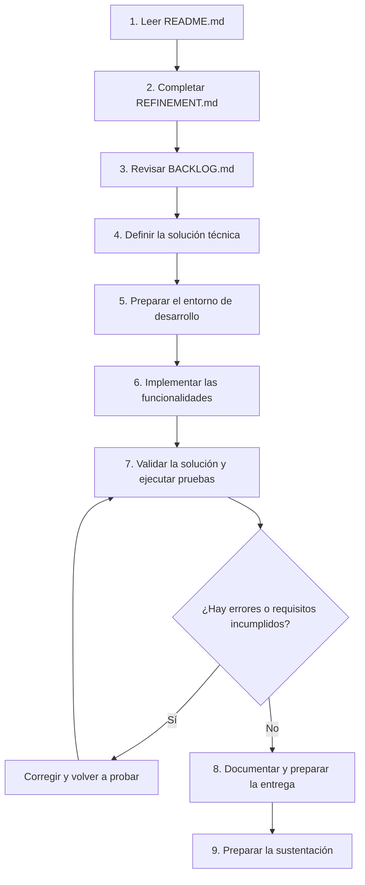

# Guía de ejecución de la prueba técnica SENA

## Objetivo

Esta guía define el orden en el que debes abordar la prueba técnica. Sigue las etapas propuestas y avanza progresivamente, verificando cada resultado antes de continuar.

## Flujo de trabajo

## Paso 1. Leer y comprender el proyecto

Comienza leyendo el archivo `README.md` del repositorio.

Identifica el objetivo de la prueba, los requerimientos, las condiciones de entrega y las restricciones establecidas.

**Resultado esperado:** comprender qué debes entregar y qué condiciones debes cumplir.

## Paso 2. Realizar el refinamiento

Lee y completa el archivo `REFINEMENT.md`.

Analiza los requerimientos, identifica las dudas o ambigüedades, establece los supuestos necesarios y documenta las decisiones que tomarías.

No comiences a programar sin haber realizado este análisis.

**Resultado esperado:** entregar el documento de refinamiento completo, con las decisiones y justificaciones correspondientes.

## Paso 3. Revisar el backlog y organizar el trabajo

Lee el archivo `BACKLOG.md` y utiliza la información obtenida en los pasos anteriores para organizar las actividades de desarrollo.

Define:
- El orden en el que implementarás las funcionalidades.
- Las tareas necesarias para cada funcionalidad.
- Las dependencias entre tareas.
- Los criterios que utilizarás para verificar cada avance.

**Resultado esperado:** contar con un plan de trabajo ordenado y priorizado.

## Paso 4. Definir la solución técnica

Selecciona las tecnologías y herramientas que utilizarás.

Define la estructura del proyecto, el modelo de datos y la forma en que se organizarán los componentes de la solución.

Documenta brevemente las decisiones técnicas y su justificación.

**Resultado esperado:** tener definido cómo vas a construir la solución antes de iniciar su implementación.

## Paso 5. Preparar el entorno de desarrollo

Configura el entorno, inicializa el proyecto y prepara el repositorio Git.

Verifica que la aplicación pueda ejecutarse y que las herramientas necesarias estén correctamente configuradas.

**Resultado esperado:** disponer de un entorno funcional para comenzar a desarrollar.

## Paso 6. Implementar las funcionalidades

Desarrolla la solución siguiendo el orden definido en el backlog.

Trabaja por funcionalidades y evita implementar todo de manera simultánea.

Para cada funcionalidad:
1. Implementa la lógica necesaria.
2. Integra los componentes correspondientes.
3. Realiza las validaciones.
4. Ejecuta las pruebas.
5. Corrige los errores encontrados.
6. Registra los cambios en Git.

**Resultado esperado:** completar progresivamente las funcionalidades definidas en la prueba.

## Paso 7. Validar la solución

Cuando hayas terminado el desarrollo, verifica que la aplicación cumpla los requerimientos y que los casos de error se gestionen correctamente.

Ejecuta las pruebas definidas, registra los resultados y corrige los problemas identificados.

**Resultado esperado:** contar con una solución funcional y con evidencias de su validación.

## Paso 8. Documentar y preparar la entrega

Actualiza el `README.md` con las instrucciones necesarias para instalar, configurar y ejecutar la aplicación.

Revisa que el repositorio contenga los archivos requeridos, la documentación, las pruebas y el historial de cambios.

**Resultado esperado:** entregar un proyecto organizado que otra persona pueda ejecutar y comprender.

## Paso 9. Preparar la sustentación

Prepara una demostración de la solución.

Debes poder explicar las decisiones tomadas durante el refinamiento, la arquitectura implementada, las principales funcionalidades, las pruebas realizadas y las dificultades que encontraste.

**Resultado esperado:** demostrar que comprendes la solución desarrollada y puedes justificar tus decisiones técnicas.

---

## Resumen del orden de ejecución

**README.md → REFINEMENT.md → BACKLOG.md → Diseño técnico → Configuración del entorno → Desarrollo → Pruebas → Documentación → Sustentación.**

Sigue este orden como guía de trabajo. Si durante el desarrollo encuentras una ambigüedad o un problema de diseño, vuelve a revisar el refinamiento y documenta cualquier decisión relevante.

La responsabilidad de analizar, diseñar, implementar y validar la solución es tuya. Puedes consultar documentación y utilizar herramientas de apoyo, siempre que comprendas y puedas explicar el trabajo entregado.
